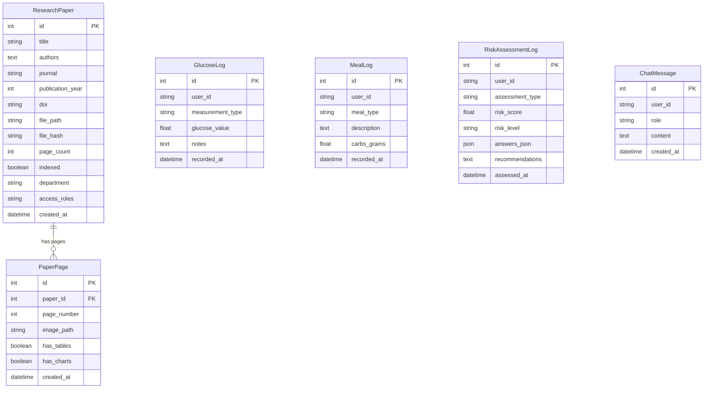

# DiaDoc AI — Backend Architecture & API Specification

> **Target Audience**: Backend Engineers, Systems Architects, and Mobile/Client Engineers (e.g., migrating or building client apps in **Flutter**, React Native, iOS/Android native, or Web).

---

## 1. Executive Summary & System Overview

**DiaDoc AI** is a clinical multimodal research intelligence and patient health tracking platform. The backend is built using **FastAPI (Python 3.10+)** and provides:
1. **Multimodal Agentic RAG Pipeline**: Combines hybrid lexical/dense retrieval (FAISS + Gemini Embeddings `gemini-embedding-001` or PaliGemma 2 `ColPali` multi-vector indexing), real-time external biomedical database enrichment (ChEMBL and ClinicalTrials.gov), and real-time streaming LLM synthesis (Google Gemini Vision models with graceful multi-model fallback or local/cloud Ollama).
2. **Server-Sent Events (SSE) Streaming**: Low-latency, token-by-token clinical generation with early metadata delivery (retrieved source cards and external biological evidence delivered before the first token).
3. **Clinical Research Paper Management**: Multipart file upload, file hash deduplication, automated PyMuPDF text parsing, PDF page image rendering, and asynchronous vector indexing.
4. **Longitudinal Glycemic & Health Telemetry**: Blood glucose logging, estimated HbA1c computation via the ADAG formula, Time-in-Range (TIR) calculations, and meal carbohydrate tracking.
5. **Standardized Clinical Risk Screening**: Calculation of combined ADA & FINDRISC risk scores with automated categorized recommendations and history logs.

---

## 2. High-Level Architecture

```
                          ┌──────────────────────────────────────────────┐
                          │     Client Application (Flutter / Mobile)    │
                          └──────────────────────┬───────────────────────┘
                                                 │
                                                 │ HTTP / REST / SSE Stream
                                                 │ Headers: Content-Type, Authorization: Bearer <JWT>
                                                 ▼
┌─────────────────────────────────────────────────────────────────────────────────────────┐
│ FastAPI Application Gateway (Uvicorn / ASGI)                                            │
│ Prefix: /api/v1  |  CORS Middleware  |  SlowAPI Rate Limiter  |  Static Files Mount     │
└────────┬───────────────────┬───────────────────┬──────────────────────┬─────────────────┘
         │                   │                   │                      │
         ▼                   ▼                   ▼                      ▼
┌─────────────────┐ ┌─────────────────┐ ┌─────────────────┐ ┌───────────────────────────┐
│  Chat / Stream  │ │ Papers & Search │ │ Patient Health  │ │ Clinical Risk Assessment  │
│  Controllers    │ │ Controllers     │ │ Controllers     │ │ Controllers               │
└────────┬────────┘ └────────┬────────┘ └────────┬────────┘ └─────────────┬─────────────┘
         │                   │                   │                        │
         ▼                   ▼                   ▼                        ▼
┌─────────────────┐ ┌─────────────────┐ ┌─────────────────┐ ┌───────────────────────────┐
│ Orchestrator    │ │ Ingestion &     │ │ HealthService   │ │ RiskService               │
│ & Agents        │ │ PDF Processor   │ │                 │ │                           │
└────────┬────────┘ └────────┬────────┘ └────────┬────────┘ └─────────────┬─────────────┘
         │                   │                   │                        │
         ├───────────────────┼───────────────────┴────────────────────────┘
         ▼                   ▼
┌─────────────────┐ ┌─────────────────┐ ┌──────────────────────┐ ┌─────────────────────────┐
│ SQLite Database │ │ Vector Indices  │ │ Upstream AI Services │ │ External Bio APIs       │
│ (SQLAlchemy)    │ │ FAISS / Byaldi  │ │ Google Gemini SDK    │ │ ChEMBL REST API         │
│                 │ │                 │ │ Ollama REST API      │ │ ClinicalTrials.gov API  │
└─────────────────┘ └─────────────────┘ └──────────────────────┘ └─────────────────────────┘
```

---

## 3. Technology Stack & Dependencies

| Layer | Technology | Purpose |
|---|---|---|
| **Framework** | **FastAPI** (`0.110.0+`), **Uvicorn** | High-performance asynchronous REST and streaming server. |
| **Data Validation** | **Pydantic v2** (`2.6.0+`), `pydantic-settings` | Strict schema validation, request/response models, environment configuration. |
| **Relational Database** | **SQLAlchemy 2.0**, SQLite (Production swappable to PostgreSQL) | Relational ORM for clinical papers, pages, glucose records, meals, risk logs, and chat turns. |
| **Auth** | **PyJWT** (HS256) + **bcrypt** | Email/password accounts, access + refresh JWTs. |
| **Rate Limiter** | **SlowAPI** | In-memory IP/Endpoint rate limiting (e.g. 20 requests/minute on streaming). |
| **Vector Retrieval** | **FAISS (CPU)** (`faiss-cpu`) + `gemini-embedding-001` (3072-dim) | High-speed, low-memory dense vector search. |
| **Visual Retrieval** | **Byaldi (ColPali / PaliGemma 2)** | Optional multi-vector late-interaction visual document search. |
| **Document Processing** | **PyMuPDF (`fitz`)**, `pdf2image`, `Pillow`, `pypdf` | PDF text extraction, metadata parsing, and per-page thumbnail rendering. |
| **Primary LLM** | **Google GenAI SDK** (`google-genai 0.1.1+`) | Multimodal chat synthesis with fallback: `gemini-3.5-flash-lite` → `gemini-3.1-flash-lite` → `gemini-3.1-flash-lite-preview` → `gemini-flash-lite-latest`. |
| **Secondary LLM** | **Ollama** (`httpx`) | Open-weights models (e.g., `gpt-oss:120b-cloud`). |
| **External APIs** | **EMBL-EBI ChEMBL**, **ClinicalTrials.gov v2** | Dynamic biomedical drug targets and recruiting clinical trials lookup. |

---

## 4. Configuration & Environment Variables

Environment variables are defined in `.env` and loaded via `app/core/config.py`:

| Variable | Type | Default Value | Description |
|---|---|---|---|
| `PROJECT_NAME` | `str` | `DiaDoc AI — Clinical Multimodal Intelligence Platform` | System name in OpenAPI docs. |
| `API_V1_STR` | `str` | `/api/v1` | Root API route prefix. |
| `DEBUG` | `bool` | `True` | Debug mode toggle. |
| `DATABASE_URL` | `str` | `sqlite:///./diabetes_assistant.db` | SQLAlchemy connection string (change to `postgresql+psycopg2://...` for production). |
| `GEMINI_API_KEY` | `str` | `""` | Google AI Studio API Key. |
| `LLM_PROVIDER` | `str` | `gemini` | Default model provider: `gemini` or `ollama`. |
| `OLLAMA_BASE_URL` | `str` | `http://127.0.0.1:11434` | Ollama HTTP endpoint. |
| `OLLAMA_MODEL` | `str` | `gpt-oss:120b-cloud` | Ollama model identifier. |
| `OLLAMA_FALLBACK_TO_GEMINI`| `bool`| `True` | Fallback to Gemini if Ollama instance fails or times out. |
| `OLLAMA_SHOW_THINKING` | `bool` | `False` | Whether to stream inner reasoning tokens. |
| `COLPALI_MODEL_NAME` | `str` | `vidore/colpali-v1.2` | PaliGemma 2 visual checkpoint. |
| `INDEX_STORE_PATH` | `str` | `<ROOT>/byaldi_index` | Base directory for FAISS and Byaldi vector indices. |
| `PAPERS_DIR` | `str` | `<ROOT>/data/papers` | Destination directory for uploaded PDF documents. |
| `RENDERED_PAGES_DIR` | `str` | `<ROOT>/rendered_pages` | Directory where PDF page PNG renderings are stored and served statically. |
| `CORS_ORIGINS` | `list` | `["http://localhost:80", "http://localhost:3000", "http://127.0.0.1:3000"]` | Allowed CORS origins for web tooling (the native Flutter app needs none). |
| `JWT_SECRET_KEY` | `str` | `""` | JWT signing secret. **Required when `DEBUG=False`**. When empty in DEBUG, an insecure dev key is used and a warning is logged. |
| `JWT_ALGORITHM` | `str` | `HS256` | JWT algorithm. |
| `ACCESS_TOKEN_EXPIRE_MINUTES` | `int` | `60` | Access-token lifetime. |
| `REFRESH_TOKEN_EXPIRE_DAYS` | `int` | `30` | Refresh-token lifetime. |
| `GEMINI_VISION_MODEL` | `str` | `gemini-3.5-flash-lite` | Model for Vision AI meal analysis. |
| `VISION_MAX_UPLOAD_MB` | `int` | `8` | Max meal-photo upload size. |

---

## 5. Database Schema & Models

The relational database layer (`app/models/db_models.py`) uses SQLAlchemy:



### Table Breakdown
1. **`research_papers`**: Stores paper metadata, file storage path, unique SHA-256 `file_hash` for duplicate prevention, page count, department categorization, and indexing status.
2. **`paper_pages`**: Links each page of a paper to its rendered PNG preview (`image_path`) and flags for structured content (`has_tables`, `has_charts`).
3. **`glucose_logs`**: Longitudinal patient readings (`Fasting`, `Postprandial`, `Random`, `HbA1c`), with a `context` ("when": `fasting`, `before_meal`, `after_meal`, `bedtime`, `random`) and reading time `recorded_at`, scoped by `user_id`.
4. **`meal_logs`**: Dietary entries (`Breakfast`, `Lunch`, `Dinner`, `Snack`), `name`, description, carbohydrate grams, `calories`, `protein_g`, `fat_g`. `recorded_at` is exposed as `logged_at`.
5. **`risk_assessment_logs`**: Snapshots of ADA/FINDRISC screening runs, user inputs in JSON, composite score, risk band, and clinical recommendations.
6. **`chat_messages`**: Durable conversation history per `user_id` (`user` vs `assistant`), indexed by composite `(user_id, created_at)`.
7. **`users`**: Accounts: unique `email`, bcrypt `password_hash`, `name`, `age`, `gender`, `height_cm`, `weight_kg`, `diabetes_type`, `photo_url`, `is_active`. Its `id` (as a string) is the `user_id` used by every other table.
8. **`user_preferences`**: One row per `user_id`: display units, language, theme, the three notification toggles (`medication_reminders`, `glucose_alerts`, `daily_tips`), daily/weekly goals and the glucose target range.
9. **`exercise_logs`**: `activity`, `duration_min`, `calories`, `intensity`, `notes`, `performed_at`.
10. **`water_logs`**: `amount_ml`, `recorded_at`.
11. **`medications`** / **`medication_doses`**: Medication schedule (`name`, `dosage`, `form`, `frequency`, `times` JSON list of `HH:MM`, `instructions`, `start_date`, `end_date`, `active`) and recorded doses (`scheduled_time`, `status` taken|skipped, `taken_at`).
12. **`notifications`**: Server-generated in-app notifications (`type`, `title`, `body`, `read`, `created_at`).

**Schema changes / migrations**: on startup `Base.metadata.create_all` creates any *missing* tables and never drops or alters existing ones. Columns added to tables that already existed (`glucose_logs.context`, `meal_logs.name/calories/protein_g/fat_g`, `research_papers.file_hash`) are applied by the idempotent `ALTER TABLE ... ADD COLUMN` step in `app/core/database.py:run_migrations` (`ADDITIVE_COLUMNS`). Existing `diabetes_assistant.db` data is kept. Add any future column there.

---

## 6. Authentication, Identity & Client Multi-Tenancy

The backend uses **email + password accounts with JWT bearer tokens** (`app/core/security.py`, `app/api/deps.py`, router `app/api/v1/endpoints/auth.py`).

- Passwords are hashed with **bcrypt**. Tokens are **HS256 JWTs** signed with `JWT_SECRET_KEY`; claims: `sub` (user id as a string), `type` (`access` | `refresh`), `iat`, `exp`.
- **Access token**: valid `ACCESS_TOKEN_EXPIRE_MINUTES` (default 60). Send it on every request as `Authorization: Bearer <access_token>`.
- **Refresh token**: valid `REFRESH_TOKEN_EXPIRE_DAYS` (default 30). Exchange it at `POST /auth/refresh` for a new pair when a call returns `401`.
- Every per-user table keys on `user_id = str(users.id)`, so the token subject is the tenant id everywhere.

### Identity resolution (`get_current_user_id`)
1. A valid Bearer access token always wins. An invalid/expired token returns **401** (`WWW-Authenticate: Bearer`).
2. **Only when `DEBUG=True`** and no token is sent: the legacy `X-User-Id` header, then the `?user_id=` query param, then `"default_user"`. This keeps scripts, Swagger and the old test suite working.
3. Otherwise **401**.

`/users/me` and `/auth/change-password` always require a token, even in DEBUG. Chat endpoints use the token user. The body `user_id` and the path `/chat/history/{user_id}` are honoured only in DEBUG without a token; with a token, a path `user_id` that is not the caller's returns 403.

Role-based department scoping in the retrieval engine still keys on special legacy ids (`clinician_endo`, `clinician_cardio`, `researcher_nutrition`). Token users (numeric ids) get unrestricted access like `default_user`.

### Auth flow for the Flutter app
```
Sign Up  ── POST /auth/register {name,email,password} ──► {access_token, refresh_token, expires_in, user}
Log In   ── POST /auth/login    {email,password}      ──► same shape
store both tokens in flutter_secure_storage
every call: Authorization: Bearer <access_token>
on 401   ── POST /auth/refresh {refresh_token} ──► new pair; retry once; if that 401s → go to Login
Log Out  ── delete stored tokens (stateless; no server call)
```

### Endpoints (`/api/v1/auth`)
| Method & path | Body | Response |
|---|---|---|
| `POST /auth/register` | `{name, email, password (≥8)}` | `201` `TokenResponse`; `409` email taken; `422` invalid |
| `POST /auth/login` | `{email, password}` | `200` `TokenResponse`; `401` wrong credentials |
| `POST /auth/refresh` | `{refresh_token}` | `200` `TokenResponse`; `401` invalid/expired/not a refresh token |
| `POST /auth/forgot-password` | `{email}` | `200 {"message": "If an account exists…"}`. This is a **stub**: no email is sent, and the response is identical whether or not the account exists. |
| `POST /auth/change-password` *(token)* | `{current_password, new_password (≥8)}` | `200 {"message": "Password updated."}`; `400` wrong current password |

`TokenResponse`:
```json
{
  "access_token": "eyJ...", "refresh_token": "eyJ...", "token_type": "bearer", "expires_in": 3600,
  "user": { "id": 1, "email": "ayesha@example.com", "name": "Ayesha", "age": null, "gender": null,
            "height_cm": null, "weight_kg": null, "diabetes_type": null, "photo_url": null,
            "bmi": null, "bmi_category": null, "created_at": "2026-11-25T10:00:00Z" }
}
```

---

## 7. Complete API Reference

Base URL prefix for all endpoints: `/api/v1`

### 7.1 System & Diagnostic Endpoints

#### `GET /`
- **Summary**: Root Health Probe
- **Response**:
  ```json
  {
    "status": "online",
    "service": "DiaDoc AI — Clinical Multimodal Intelligence Platform",
    "version": "2.0.0",
    "docs": "/docs",
    "openapi": "/api/v1/openapi.json",
    "stream_endpoint": "/api/v1/chat/stream"
  }
  ```

#### `GET /api/v1/health`
- **Summary**: Comprehensive Subsystem Diagnostics
- **Response** (`200 OK`):
  ```json
  {
    "status": "healthy",
    "version": "2.0.0",
    "components": {
      "database": {
        "ok": true,
        "papers_indexed": 12,
        "chat_messages": 34
      },
      "colpali_index": {
        "ok": true,
        "index_path": "...",
        "note": "Ready"
      },
      "text_index": {
        "ok": true,
        "note": "Ready — CPU-friendly FAISS index"
      },
      "active_engine": "TextEngine (FAISS + Gemini Embeddings — CPU-friendly)",
      "rendered_pages": {
        "ok": true,
        "count": 142
      },
      "llm_provider": {
        "configured": "gemini",
        "ollama": {
          "ok": false,
          "model": "gpt-oss:120b-cloud",
          "base_url": "http://127.0.0.1:11434",
          "models_available": []
        },
        "gemini": {
          "api_key_set": true
        }
      }
    }
  }
  ```

---

### 7.2 LLM Engine Management

#### `GET /api/v1/llm/providers`
- **Summary**: List Available LLM Providers & Health
- **Response** (`200 OK`):
  ```json
  {
    "active_provider": "gemini",
    "providers": {
      "gemini": {
        "available": true,
        "configured": true,
        "default_model": "gemini-3.5-flash-lite",
        "description": "Google Gemini multimodal vision models"
      },
      "ollama": {
        "available": false,
        "base_url": "http://127.0.0.1:11434",
        "model": "gpt-oss:120b-cloud",
        "installed_models": []
      }
    }
  }
  ```

#### `POST /api/v1/llm/provider`
- **Summary**: Switch Active LLM Provider at Runtime
- **Request Body**:
  ```json
  {
    "provider": "ollama"
  }
  ```
- **Response** (`200 OK`):
  ```json
  {
    "status": "success",
    "active_provider": "ollama",
    "message": "Active LLM provider successfully set to 'ollama'."
  }
  ```

---

### 7.3 Multimodal RAG Chat & Streaming

#### `POST /api/v1/chat/stream` *(Primary Clinical Endpoint)*
- **Protocol**: Server-Sent Events (`text/event-stream`)
- **Rate Limit**: `20 requests/minute` per client IP
- **Request Body**:
  ```json
  {
    "query": "How do SGLT2 inhibitors affect HbA1c and renal protection?",
    "user_id": "default_user",
    "provider": "gemini"
  }
  ```

##### Event Flow Specification (SSE)
Each event emitted follows standard SSE format: `data: <JSON_STRING>\n\n`. The Flutter client should listen to the stream and parse each event object by its `type`:

| Event `type` | Payload Keys | Description | Client Action |
|---|---|---|---|
| `status` | `message` (string) | Pipeline phase indicator (e.g., `"🔍 Analyzing query intent & expanding..."`, `"📄 Running FAISS Text Search..."`, `"🧠 Synthesising answer..."`). | Display dynamic progress indicator or animated status pill. |
| `sources` | `sources` (array of objects) | List of retrieved pages/papers that will ground the answer. Emitted **before** tokens begin streaming. | Populate the citation reference drawer or preview carousel. |
| `bio_metadata`| `bio_metadata` (object) | External drug data from ChEMBL & recruiting trials from ClinicalTrials.gov. | Render drug compound badges and trial cards. |
| `token` | `content` (string) | Incremental text chunk generated by the LLM. | Append `content` directly to the active assistant response bubble. |
| `error` | `content` (string) | Error or safety restriction notice. | Render alert banner / error state in chat. |
| `done` | `execution_mode`, `timing` (`{total_ms}`) | Final event signaling stream termination. | Stop loading spinner, record metrics. |

##### Example Source Object in `sources` event:
```json
{
  "paper_id": 1,
  "title": "Standards of Care in Diabetes — 2026",
  "authors": "American Diabetes Association",
  "journal": "Diabetes Care",
  "publication_year": 2026,
  "page_number": 14,
  "score": 0.892,
  "department": "Endocrinology",
  "image_url": "/rendered_pages/standards-of-care-2026_page_14.png"
}
```

##### Example `bio_metadata` event:
```json
{
  "type": "bio_metadata",
  "bio_metadata": {
    "chembl_data": {
      "empagliflozin": {
        "chembl_id": "CHEMBL2107830",
        "pref_name": "EMPAGLIFLOZIN",
        "molecule_type": "Small molecule",
        "first_approval": 2014,
        "molecular_weight": "450.91"
      }
    },
    "clinical_trials_data": {
      "Type 2 Diabetes": {
        "total_count": 84,
        "top_trials": [
          {
            "nct_id": "NCT05214560",
            "title": "Empagliflozin in Patients with Type 2 Diabetes",
            "phase": "PHASE3",
            "status": "RECRUITING"
          }
        ]
      }
    }
  }
}
```

#### `POST /api/v1/chat` *(Non-Streaming Fallback)*
- **Request Body**: Same as `/chat/stream` (`ChatQueryRequest`)
- **Response** (`200 OK`): Complete JSON object containing `answer`, `sources`, `bio_metadata`, and `timing`.

> **Identity**: chat endpoints use the Bearer-token user. The body `user_id` is ignored when a token is sent and is honoured only in DEBUG.

#### `GET /api/v1/chat/history` *(preferred)* · `DELETE /api/v1/chat/history`
Same as the legacy forms below, scoped to the token user.

#### `GET /api/v1/chat/history/{user_id}` *(legacy)*
- With a token, `user_id` must equal the token user (otherwise `403`). Without a token, this works only in DEBUG.
- **Summary**: Retrieve Conversation History
- **Query Params**: `limit` (default: 20)
- **Response** (`200 OK`):
  ```json
  [
    {
      "role": "user",
      "content": "What is the recommended target for HbA1c?",
      "created_at": "2026-10-22T19:40:00.000000"
    },
    {
      "role": "assistant",
      "content": "According to the ADA Guidelines, the general target is < 7.0%...",
      "created_at": "2026-10-22T19:40:04.000000"
    }
  ]
  ```

#### `DELETE /api/v1/chat/history/{user_id}` *(legacy, same rules)*
- **Summary**: Reset/Clear User History (Clears both in-memory rolling window and SQLite).
- **Response** (`200 OK`):
  ```json
  {
    "cleared": 6,
    "user_id": "default_user"
  }
  ```

---

### 7.4 Research Papers & Document Management

#### `GET /api/v1/papers`
- **Summary**: Catalog of Indexed Research Papers
- **Query Params**: `department` (optional filter, e.g. `Endocrinology`, `Cardiology`, `Nutrition`, or `All`)
- **Response** (`200 OK`):
  ```json
  [
    {
      "id": 1,
      "title": "Standards of Medical Care in Diabetes—2026",
      "authors": "American Diabetes Association Professional Practice Committee",
      "journal": "Diabetes Care",
      "publication_year": 2026,
      "doi": "10.2337/dc26-S001",
      "file_path": ".../data/papers/standards_2026.pdf",
      "page_count": 112,
      "indexed": true,
      "created_at": "2026-10-20T12:00:00",
      "image_url": "/rendered_pages/standards_2026_page_1.png",
      "department": "Endocrinology",
      "access_roles": "clinical,research"
    }
  ]
  ```

#### `POST /api/v1/papers/upload`
- **Content-Type**: `multipart/form-data`
- **Payload**: `file` (Binary PDF file, max 50MB)
- **Validations Enforced**:
  - Validates `%PDF-` byte header magic numbers.
  - Enforces `.pdf` extension and prevents path traversal (`..`, `/`, `\`).
  - Computes SHA-256 hash. If the document already exists in SQLite, it skips re-indexing and returns the existing record immediately.
  - Generates PNG renderings for each page under `rendered_pages/`.
  - Computes 3072-dimensional vector embeddings for each page and adds them to `text_index/faiss.index`.
- **Response** (`200 OK`):
  ```json
  {
    "status": "success",
    "paper_id": 2,
    "title": "Dual SGLT2 and GLP-1 RA Clinical Outcomes",
    "page_count": 18,
    "indexed_pages": 18,
    "message": "Paper successfully processed and indexed into FAISS."
  }
  ```

#### `POST /api/v1/search`
- **Summary**: Direct Visual / Text Vector Search over Literature
- **Request Body**:
  ```json
  {
    "query": "Time in range glycemic targets",
    "top_k": 5
  }
  ```
- **Response** (`200 OK`):
  ```json
  {
    "query": "Time in range glycemic targets",
    "total_results": 5,
    "results": [
      {
        "paper_id": 1,
        "title": "Standards of Care in Diabetes",
        "page_number": 8,
        "score": 0.912,
        "image_path": "C:/.../rendered_pages/standards_page_8.png",
        "image_url": "/rendered_pages/standards_page_8.png",
        "authors": "ADA",
        "journal": "Diabetes Care",
        "publication_year": 2026
      }
    ]
  }
  ```

#### `POST /api/v1/ingest`
- **Summary**: Background Re-indexing Trigger
- Spawns background worker thread to re-run indexing over all PDFs in `data/papers/` and automatically purges search memory caches.

---

### 7.5 Patient Longitudinal Health Tracking

See §7.7 for shared conventions (auth, UTC datetimes, `?date=` / `?days=` / `?tz_offset=`).

#### `POST /api/v1/health-logs/glucose`
- **Summary**: Add a Blood Glucose Reading
- **Headers**: `Authorization: Bearer <access_token>`
- **Request Body**: send `when` (from the Figma "When" picker) or the legacy `measurement_type`. The other is derived: `fasting→Fasting`, `after_meal→Postprandial`, `before_meal|bedtime|random→Random`.
  ```json
  {
    "glucose_value": 118.5,                     // mg/dL, or % if measurement_type is "HbA1c"
    "when": "before_meal",                      // fasting | before_meal | after_meal | bedtime | random
    "recorded_at": "2026-11-25T08:30:00+05:00", // optional reading time, default now
    "notes": "Before morning walk",
    "measurement_type": null                    // optional legacy: Fasting | Postprandial | Random | HbA1c
  }
  ```
- **Response** (`200 OK`) — `GlucoseLog`:
  ```json
  {
    "id": 14, "user_id": "1", "measurement_type": "Random", "glucose_value": 118.5,
    "notes": "Before morning walk", "when": "before_meal",
    "status": "normal",
    "recorded_at": "2026-11-25T03:30:00Z"
  }
  ```
  `status` is `low | normal | high` against the user's target range, and `null` for HbA1c. A `low` or `high` reading creates an `alert` notification when the `glucose_alerts` preference is on.

#### `GET /api/v1/health-logs/glucose?date=YYYY-MM-DD | days=N &tz_offset=`
- **Response**: `[GlucoseLog]`, newest first. With no filter, it returns all readings.

#### `DELETE /api/v1/health-logs/glucose/{id}` → `204`

#### `GET /api/v1/health-logs/glucose/summary`
- **Summary**: Compute Clinical Glycemic Metrics & Time-in-Range
- **Headers**: `Authorization: Bearer <access_token>`
- **Query Params**: `days` (integer, default: 30)
- **Clinical Calculation Logic**:
  - Filters records from `datetime.utcnow() - timedelta(days=days)` excluding standalone `HbA1c` entries.
  - **Time in Range (TIR)**: $\% \text{ of values where } 70 \le \text{glucose} \le 180 \text{ mg/dL}$.
  - **Hyperglycemia**: Count of values $> 180 \text{ mg/dL}$.
  - **Hypoglycemia**: Count of values $< 70 \text{ mg/dL}$.
  - **Estimated HbA1c (ADAG Equation)**: $eA1c = \frac{\text{Average Glucose} + 46.7}{28.7}$
- **Response** (`200 OK`):
  ```json
  {
    "total_readings": 28,
    "average_glucose": 132.4,
    "time_in_range_percent": 82.1,
    "estimated_hba1c": 6.2,
    "hyperglycemia_readings": 4,
    "hypoglycemia_readings": 1,
    "status": "Optimal Glycemic Control"
  }
  ```

#### `POST /api/v1/health-logs/meals`
- **Summary**: Log Patient Meal, Carbohydrates & Macros
- **Headers**: `Authorization: Bearer <access_token>`
- **Request Body** (only `meal_type` is required; the numbers are optional and ≥ 0):
  ```json
  {
    "meal_type": "Lunch",
    "name": "Grilled chicken bowl",
    "description": "Grilled chicken breast with steamed broccoli and brown rice",
    "carbs_grams": 45.0, "calories": 520, "protein_g": 38, "fat_g": 14,
    "logged_at": "2026-11-25T13:10:00+05:00"
  }
  ```
  `meal_type`: `Breakfast | Lunch | Dinner | Snack`. `description` defaults to `name`. `logged_at` defaults to now.
- **Response** (`200 OK`) — `MealLog`: `{id, user_id, meal_type, name, description, carbs_grams, calories, protein_g, fat_g, logged_at}`

#### `GET /api/v1/health-logs/meals?date= | days= &tz_offset=`
- **Response**: `[MealLog]`, newest first.

#### `GET /api/v1/health-logs/meals/daily-totals?date=&tz_offset=`
- **Response**:
  ```json
  {
    "date": "2026-11-25",
    "totals": {"calories": 850.0, "carbs_g": 110.0, "protein_g": 10.0, "fat_g": 6.0, "meal_count": 2},
    "goals": {"calories": 2000, "carbs_g": 200},
    "by_meal_type": {"Breakfast": {"calories": 300.0, "carbs_g": 40.0, "protein_g": 10.0, "fat_g": 6.0, "meal_count": 1}}
  }
  ```

#### `DELETE /api/v1/health-logs/meals/{id}` → `204`

---

### 7.6 Clinical Diabetes Risk Screening

#### `POST /api/v1/risk-assessment`
- **Summary**: Calculate Standardized ADA & FINDRISC Risk Score
- **Headers**: `Authorization: Bearer <access_token>` (`X-User-Id` accepted only in DEBUG)
- **Request Body**:
  ```json
  {
    "age": 52,
    "gender": "Male",
    "bmi": 28.4,
    "family_history": true,
    "high_blood_pressure": true,
    "physical_activity": "sedentary",
    "ethnicity": "Non-Hispanic White"
  }
  ```
- **Clinical Scoring Algorithm**:
  - Age: $\ge 65 \rightarrow +4$, $50\text{--}64 \rightarrow +3$, $40\text{--}49 \rightarrow +2$.
  - BMI: $\ge 30 \rightarrow +3$, $25\text{--}29.9 \rightarrow +1$.
  - First-degree family relative: $+5$.
  - Diagnosed Hypertension: $+2$.
  - Inactivity/Sedentary: $+2$.
  - **Tiers**:
    - $\text{Score} \ge 12 \rightarrow$ **Very High**
    - $8 \le \text{Score} < 12 \rightarrow$ **High**
    - $5 \le \text{Score} < 8 \rightarrow$ **Moderate**
    - $\text{Score} < 5 \rightarrow$ **Low**
- **Response** (`200 OK`):
  ```json
  {
    "assessment_type": "ADA & FINDRISC Combined Standardized Score",
    "risk_score": 13.0,
    "risk_level": "Very High",
    "summary": "Very High probability of Type 2 Diabetes or Prediabetes. Immediate medical consultation recommended.",
    "recommendations": [
      "Schedule a Diagnostic Fasting Plasma Glucose & HbA1c blood test with your healthcare provider.",
      "Initiate structured low-carbohydrate nutritional guidance (supported by clinical literature).",
      "Aim for 150+ minutes of weekly moderate aerobic and resistance exercise.",
      "Discuss preventive pharmacological interventions (e.g. Metformin / SGLT2 inhibitors) with an endocrinologist."
    ]
  }
  ```

#### `POST /api/v1/risk-assessment/cdc` *(CDC 7-question prediabetes test — used by RA0–RA7 / Risk Results)*
- **Headers**: `Authorization: Bearer <access_token>`
- **Request Body**:
  ```json
  {
    "age": 52,
    "sex": "male",                  // "male" | "female"
    "gestational_diabetes": false,  // only counts for women
    "family_history": true,         // mother, father, sister or brother with diabetes
    "high_blood_pressure": false,
    "physically_active": false,
    "weight_kg": 95, "height_cm": 175,   // or "bmi": 31.0; if both are omitted the saved profile is used
    "asian_american": false,        // optional: CDC's lower BMI cut-offs
    "save": true                    // default true: store in history + notification
  }
  ```
- **Scoring** (paper test totals 11):
  | Question | Points |
  |---|---|
  | Q1 Age | <40: 0 · 40–49: 1 · 50–59: 2 · ≥60: 3 |
  | Q2 Sex | man: 1 · woman: 0 |
  | Q3 Gestational diabetes | woman, yes: 1 |
  | Q4 Family history | yes: 1 |
  | Q5 High blood pressure | yes: 1 |
  | Q6 Physically active | no: 1 |
  | Q7 Weight (BMI band) | <25: 0 · 25–<30: 1 · 30–<40: 2 · ≥40: 3 (Asian American: 23 / 27.5 / 37.5) |

  **Bands**: score ≥ 5 → `High` (`at_risk: true`, the CDC threshold) · 3–4 → `Moderate` · 0–2 → `Low`. Q2 and Q3 can't both score, so one person's real maximum is 10.
- **Response** (`200 OK`):
  ```json
  {
    "id": 41, "assessment_type": "CDC_PREDIABETES", "score": 7, "max_score": 11,
    "risk_level": "High", "at_risk": true, "bmi": 31.0,
    "factors": [
      {"key": "age", "question": "How old are you?", "answer": "52 (50–59)", "points": 2, "max_points": 3},
      {"key": "sex", "question": "Are you a man or a woman?", "answer": "Male", "points": 1, "max_points": 1},
      {"key": "gestational_diabetes", "question": "...", "answer": "Not applicable", "points": 0, "max_points": 1},
      {"key": "family_history", "question": "...", "answer": "Yes", "points": 1, "max_points": 1},
      {"key": "high_blood_pressure", "question": "...", "answer": "No", "points": 0, "max_points": 1},
      {"key": "physical_activity", "question": "Are you physically active?", "answer": "No", "points": 1, "max_points": 1},
      {"key": "weight", "question": "What is your weight category?", "answer": "BMI 31.0 (30.0–40.0)", "points": 2, "max_points": 3}
    ],
    "summary": "Your score of 7/11 means you are at high risk ...",
    "recommendations": ["Ask your doctor for an HbA1c or fasting plasma glucose test ...", "..."],
    "assessed_at": "2026-11-25T10:00:00Z"
  }
  ```
  `id` is `null` when `save=false`. Saved results appear in `/risk-assessment/history` with `assessment_type: "CDC_PREDIABETES"` and `risk_score` = the score.

#### `GET /api/v1/risk-assessment/history`
- **Summary**: Retrieve Historical Risk Assessments for User
- **Headers**: `Authorization: Bearer <access_token>` (`X-User-Id` accepted only in DEBUG)
- **Response** (`200 OK`): Array of historical screening logs.

---

### 7.7 Conventions for the mobile endpoints (7.5 onward)

- **Auth**: `Authorization: Bearer <access_token>` on every call (see §6).
- **Datetimes in responses** are UTC and timezone-aware (`"2026-11-25T08:30:00Z"`). Request datetimes may carry an offset; if they have none, they are treated as UTC.
- **Date filters**: `?date=YYYY-MM-DD` (one local day) or `?days=N` (the last N local days including today). Neither returns everything. Add `?tz_offset=<minutes>` (the client's UTC offset, e.g. `300` for UTC+05:00) so "today" matches the phone's calendar day. It defaults to `0` (UTC).
- **Weeks** run Monday–Sunday. `?week=` takes any date inside the week.
- `DELETE` endpoints return `204`. A missing or foreign id returns `404`.

### 7.8 User Profile & Preferences (`/api/v1/users`)

| Method & path | Body | Response |
|---|---|---|
| `GET /users/me` *(token required)* | – | `UserProfile` |
| `PUT /users/me` *(token required)* | partial: `name, email, age (1–120), gender (male\|female\|other), height_cm, weight_kg, diabetes_type (type1\|type2\|gestational\|prediabetes\|none\|other), photo_url` | `UserProfile`. `409` if the email is taken |
| `GET /users/me/preferences` | – | `Preferences` (created with defaults on first read) |
| `PUT /users/me/preferences` | partial `Preferences` | `Preferences`. `422` if `target_glucose_min ≥ target_glucose_max` |

`UserProfile` = `{id, email, name, age, gender, height_cm, weight_kg, diabetes_type, photo_url, bmi, bmi_category, created_at}`. `bmi` is computed as weight/height² (1 dp). `bmi_category` is one of `Underweight|Normal|Overweight|Obese`.

`Preferences` (defaults):
```json
{ "glucose_unit": "mg/dL", "weight_unit": "kg", "height_unit": "cm", "language": "en", "theme": "system",
  "medication_reminders": true, "glucose_alerts": true, "daily_tips": true,
  "water_goal_ml": 2000, "weekly_exercise_goal_min": 150, "daily_calorie_goal": 2000, "daily_carbs_goal_g": 200,
  "target_glucose_min": 70.0, "target_glucose_max": 180.0 }
```
`glucose_unit`: `mg/dL|mmol/L` · `weight_unit`: `kg|lb` · `height_unit`: `cm|ft` · `theme`: `light|dark|system`. Values are always **stored in mg/dL, kg and cm**. The unit fields only tell the client how to display them.

### 7.9 Exercise (`/api/v1/health-logs/exercise`)

| Method & path | Notes |
|---|---|
| `POST /health-logs/exercise` | `{activity, duration_min (1–1440), calories?, intensity? (low\|moderate\|high), notes?, performed_at?}` → `ExerciseLog` |
| `GET /health-logs/exercise?date=\|days=` | `[ExerciseLog]`, newest first |
| `GET /health-logs/exercise/weekly-summary?week=` | `{week_start, week_end, total_minutes, goal_minutes, goal_percent, active_days, sessions, calories, by_day: [{date, minutes}×7]}` |
| `DELETE /health-logs/exercise/{id}` | `204` |

`ExerciseLog` = `{id, activity, duration_min, calories, intensity, notes, performed_at}`. Reaching the weekly goal creates an `achievement` notification.

### 7.10 Water (`/api/v1/health-logs/water`)

| Method & path | Notes |
|---|---|
| `POST /health-logs/water` | `{amount_ml (1–5000), recorded_at?}` → `{id, amount_ml, recorded_at}` |
| `GET /health-logs/water?date=\|days=` | list, newest first |
| `GET /health-logs/water/daily?date=` | `{date, total_ml, goal_ml, percent, remaining_ml, entries: [...]}` |
| `DELETE /health-logs/water/{id}` | `204` |

Crossing the daily goal creates an `achievement` notification.

### 7.11 Medications (`/api/v1/medications`)

| Method & path | Notes |
|---|---|
| `POST /medications` | `{name, dosage?, form?, frequency? (default once_daily), times: ["08:00","20:00"], instructions?, start_date?, end_date?, active (default true)}` → `201 Medication`. Times are local `HH:MM` (24 h), sorted and de-duplicated |
| `GET /medications?active_only=` | `[Medication]` sorted by name |
| `GET /medications/today?date=` | `{date, scheduled, taken, items: [{medication_id, name, dosage, time, status (taken\|skipped\|pending), dose_id, taken_at}]}`. Use this for the medication screen's checklist |
| `GET /medications/adherence?week=` | `{week_start, week_end, scheduled, taken, adherence_percent, by_day: [{date, scheduled, taken, adherence_percent}×7], by_medication: [{medication_id, name, scheduled, taken, adherence_percent}]}` |
| `GET /medications/{id}` · `PUT /medications/{id}` (partial) · `DELETE /medications/{id}` | |
| `POST /medications/{id}/doses` | `{scheduled_time? ("08:00", must be one of the med's times), status (taken\|skipped, default taken), taken_at?}` → `201 {id, medication_id, scheduled_time, status, taken_at}` |
| `GET /medications/{id}/doses?date=\|days=` | list of doses |

`Medication` = `{id, name, dosage, form, frequency, times, instructions, start_date, end_date, active, created_at}`. Each day a medication has one slot per entry in `times`, or a single unscheduled slot when `times` is empty. It counts only on days when it is active and inside `start_date`/`end_date`.

### 7.12 Notifications (`/api/v1/notifications`)

The server creates notifications for these events: a welcome message on sign-up; `alert` for glucose readings outside the target range (when `glucose_alerts` is on); `achievement` for the water and weekly-exercise goals; `info` when a CDC risk test is saved.

| Method & path | Response |
|---|---|
| `GET /notifications?unread_only=&limit=50` | `{items: [{id, type (info\|alert\|reminder\|achievement), title, body, read, created_at}], unread_count}` |
| `POST /notifications/mark-all-read` | `{updated}` |
| `POST /notifications/{id}/read` | the notification |
| `DELETE /notifications/{id}` | `204` |

### 7.13 Home Dashboard — `GET /api/v1/dashboard?tz_offset=`

One call for the home screen:
```json
{
  "date": "2026-11-25",
  "user": {"id": 1, "name": "Ayesha", "photo_url": null},
  "glucose": {
    "latest": { "...GlucoseLog" : "or null" },
    "unit": "mg/dL", "target_min": 70.0, "target_max": 180.0,
    "sparkline": [{"date": "2026-11-19", "average": 132.0, "readings": 2}, "... 7 days, average null when no data"],
    "last_7_days": {"readings": 9, "average": 128.4, "time_in_range_percent": 88.9, "estimated_hba1c": 6.1,
                    "hypo_readings": 0, "hyper_readings": 1, "min": 92.0, "max": 196.0}
  },
  "water": {"total_ml": 1250, "goal_ml": 2000, "percent": 62.5},
  "exercise": {"today_minutes": 30, "today_calories": 120.0, "week_minutes": 95, "weekly_goal_minutes": 150},
  "meals": {"calories": 850.0, "carbs_g": 110.0, "protein_g": 30.0, "fat_g": 20.0, "meal_count": 2,
            "calorie_goal": 2000, "carbs_goal_g": 200},
  "medications": {"scheduled_today": 3, "taken_today": 1, "next_dose": {"medication_id": 2, "name": "Metformin", "dosage": "500 mg", "time": "20:00", "status": "pending", "dose_id": null, "taken_at": null}},
  "reminders": [{"type": "medication", "title": "Take Metformin 500 mg", "time": "20:00", "medication_id": 2}],
  "unread_notifications": 2,
  "last_risk_assessment": {"id": 7, "assessment_type": "CDC_PREDIABETES", "score": 4.0, "risk_level": "Moderate", "assessed_at": "2026-11-20T09:00:00Z"}
}
```

### 7.14 Analytics — `GET /api/v1/analytics/summary?month=YYYY-MM&tz_offset=`

```json
{
  "month": "2026-11", "days_in_month": 30, "days_elapsed": 25,
  "glucose": {"readings": 60, "average": 134.2, "time_in_range_percent": 81.7, "estimated_hba1c": 6.3,
              "hypo_readings": 1, "hyper_readings": 10, "min": 65.0, "max": 240.0,
              "target_min": 70.0, "target_max": 180.0,
              "previous_month_average": 142.0, "trend": "improving",
              "daily": [{"date": "2026-11-01", "average": 130.0, "readings": 2}, "..."],
              "weekly": [{"week_start": "2026-10-27", "average": 131.0, "readings": 8}, "..."]},
  "nutrition": {"meals_logged": 70, "days_logged": 24, "avg_carbs_per_day": 165.0, "avg_calories_per_day": 1850.0},
  "exercise": {"sessions": 14, "active_days": 12, "total_minutes": 420, "total_calories": 2100.0},
  "water": {"avg_ml_per_day": 1800.0, "days_goal_met": 9, "goal_ml": 2000},
  "medication_adherence_percent": 86.7
}
```
`trend` compares this month's average glucose with the previous month's. It is `stable` when the difference is under 5 mg/dL, otherwise `improving` (lower) or `worsening` (higher). It is `insufficient_data` when either month has no readings. Statistics exclude HbA1c entries.

### 7.15 Vision AI — `POST /api/v1/vision/meal-analysis`

`multipart/form-data` with these fields:
- `image`: required file, `image/jpeg|png|webp|heic|heif`, at most `VISION_MAX_UPLOAD_MB` (default 8)
- `save`: optional bool. When true, the result is also logged as a meal.
- `meal_type`: optional, default `Snack`. Used only with `save=true`.

The image goes to Gemini (`GEMINI_VISION_MODEL`, default `gemini-3.5-flash-lite`) with a strict-JSON nutrition prompt. Rate limit: 15/minute.
```json
{
  "food": "Chicken biryani", "confidence": 0.87,
  "items": [{"name": "Rice", "portion": "1.5 cups", "carbs_g": 60.0, "calories": 300.0}],
  "carbs_g": 62.0, "calories": 610.0, "protein_g": 32.0, "fat_g": 22.0,
  "glycemic_index": 65.0, "glycemic_load": 40.3, "glycemic_load_category": "high",
  "advice": "Pair with a salad and a smaller rice portion.", "model": "gemini-3.5-flash-lite",
  "saved_meal_id": 12
}
```
Glycemic load is GI × carbs / 100. When the model gives no GI, a GI of 55 is assumed. Categories: low ≤ 10, medium 11–19, high ≥ 20. Errors: `415` unsupported type, `400` empty file, `413` too large, `422` no food recognised or the model failed, `503` `GEMINI_API_KEY` not configured.

---

## 8. Static Media & Assets Hosting

The backend serves all converted PDF page preview PNG files statically via FastAPI:
- **Mount Path**: `/rendered_pages`
- **Directory**: `settings.RENDERED_PAGES_DIR` (`backend/rendered_pages/`)
- **URL Resolution Pattern**:
  When an API endpoint returns an `image_url` like `"/rendered_pages/standards_page_1.png"`, client applications resolve it against the backend server host:
  $$\text{Full URL} = \text{http://<BACKEND\_HOST>:<PORT>} + \text{image\_url}$$
  *(e.g., `http://10.0.2.2:8000/rendered_pages/standards_page_1.png` in Android emulator or `http://localhost:8000/rendered_pages/...` on desktop).*

---

## 9. Architectural Blueprint for Flutter / Mobile Migration

When designing a Flutter client to consume this backend, follow this architectural setup:

### 9.1 Recommended Dart / Flutter Packages
- **Networking**: `dio: ^5.4.0` or `http: ^1.2.0`
- **Server-Sent Events (SSE)**: `fetch_client` or `flutter_client_sse: ^1.2.0` or native Dart `StreamedResponse` from `http.Client().send()`
- **State Management**: `flutter_riverpod: ^2.5.0` or `bloc: ^8.1.0`
- **Markdown & Tables**: `flutter_markdown: ^0.7.0` (with GitHub-flavored markdown table support)
- **Cached Images**: `cached_network_image: ^3.3.0` (to cache PDF page previews)
- **Local Storage**: `shared_preferences` or `flutter_secure_storage` (store the access + refresh JWTs in `flutter_secure_storage`)

### 9.2 Handling Android Emulator vs iOS Simulator Networking
- **Android Emulator**: Localhost is accessible at `http://10.0.2.2:8000`.
- **iOS Simulator**: Localhost is accessible at `http://127.0.0.1:8000`.
- **Physical Device**: Connect phone and backend to the same Wi-Fi network and use your machine's LAN IP (e.g., `http://192.168.1.50:8000`).

### 9.3 Dart SSE Stream Consumer Example
Here is the recommended Flutter implementation for consuming `/api/v1/chat/stream`:

```dart
import 'dart:async';
import 'dart:convert';
import 'package:http/http.dart' as http;

class ChatStreamService {
  final String baseUrl;
  ChatStreamService({required this.baseUrl});

  Stream<Map<String, dynamic>> streamChat({
    required String query,
    required String accessToken,
    String? provider,
  }) async* {
    final client = http.Client();
    final request = http.Request('POST', Uri.parse('$baseUrl/api/v1/chat/stream'));
    request.headers.addAll({
      'Content-Type': 'application/json',
      'Accept': 'text/event-stream',
      'Authorization': 'Bearer $accessToken',
    });
    request.body = jsonEncode({
      'query': query,
      'provider': provider,
    });

    final response = await client.send(request);

    if (response.statusCode != 200) {
      throw Exception('Server error: ${response.statusCode}');
    }

    String buffer = '';
    await for (final chunk in response.stream.transform(utf8.decoder)) {
      buffer += chunk;
      final lines = buffer.split('\n');
      buffer = lines.removeLast(); // Keep trailing incomplete segment

      for (final line in lines) {
        final trimmed = line.trim();
        if (trimmed.startsWith('data: ')) {
          final jsonStr = trimmed.substring(6).trim();
          if (jsonStr.isNotEmpty) {
            try {
              final Map<String, dynamic> event = jsonDecode(jsonStr);
              yield event;
            } catch (e) {
              // Ignore malformed chunks
            }
          }
        }
      }
    }
  }
}
```

### 9.4 State Machine for the Chat Screen
In your Riverpod or Bloc controller, listen to the stream above:
1. `event['type'] == 'status'` $\rightarrow$ Set `statusMessage = event['message']`
2. `event['type'] == 'sources'` $\rightarrow$ Set `sources = (event['sources'] as List).map(SourceItem.fromJson).toList()`
3. `event['type'] == 'bio_metadata'` $\rightarrow$ Set `bioMetadata = BioMetadata.fromJson(event['bio_metadata'])`
4. `event['type'] == 'token'` $\rightarrow$ Append `event['content']` to message text and notify UI.
5. `event['type'] == 'error'` $\rightarrow$ Show error dialog/banner and stop loading.
6. `event['type'] == 'done'` $\rightarrow$ Finalize message state, record timing, clear spinner.

---

## 10. Verification, Testing & Operational Commands

### Running the Backend Server
```bash
# From workspace root
back.bat

# Or directly in terminal:
cd backend
python -m uvicorn app.main:app --host 0.0.0.0 --port 8000 --reload
```

### Running Test Suite
```bash
cd backend
pytest -v
```

### Ingestion Script (Building Vector Index)
```bash
cd backend
# Lightweight CPU FAISS ingestion (recommended):
python scripts/ingest_papers_lightweight.py

# Or GPU Byaldi ColPali visual indexing:
python scripts/ingest_papers.py
```
