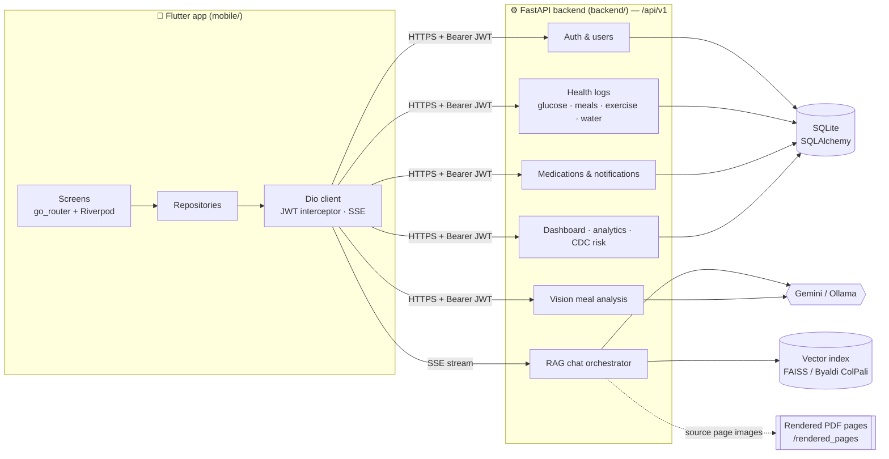

# AIMS Diabetes

**An AI-assisted diabetes self-management app.** A Flutter mobile client for tracking glucose, meals, exercise, water and medications, backed by a FastAPI service with a research-grounded AI assistant, photo-based meal analysis, and the CDC prediabetes risk test.


> **Medical disclaimer.** AIMS Diabetes is a self-tracking and education tool. It does not diagnose, treat or replace a clinician. Risk scores and AI answers are informational only.

---

## Contents

- [Features](#features)
- [Architecture](#architecture)
- [Repository layout](#repository-layout)
- [Quick start](#quick-start)
- [Configuration](#configuration)
- [Running the mobile app](#running-the-mobile-app)
- [Research corpus (AI assistant knowledge)](#research-corpus-ai-assistant-knowledge)
- [API overview](#api-overview)
- [Testing](#testing)
- [Deployment](#deployment)
- [Security notes](#security-notes)
- [Troubleshooting](#troubleshooting)
- [Documentation](#documentation)

---

## Features

| Area | What the user gets |
|---|---|
| **Accounts** | Email + password sign-up / sign-in, forgot-password flow, change password. JWT access + refresh tokens stored in the device keystore. |
| **Home dashboard** | Greeting, latest glucose with a 7-day sparkline and in-range badge, quick actions, today's water / exercise / medication progress, upcoming doses, last risk result, notification bell with unread count. |
| **AI Assistant** | Chat with an assistant that answers from a corpus of clinical research papers. Answers stream token by token, show live status ("Searching…", "Synthesising…"), render markdown, and include source cards that open the exact PDF page. |
| **Glucose** | Log readings with context (fasting, before/after meal, bedtime, random); 7-day chart with the 70–180 mg/dL target band; average, time-in-range and readings/day. |
| **Meals** | Log meals with carbs, calories, protein and fat; daily calorie ring and macro bars against goals. |
| **Vision AI** | Photograph a meal — Gemini vision estimates the food, confidence, carbs, calories, macros and glycemic load, then pre-fills the Add Meal form. |
| **Exercise & water** | Workout log with intensity and a weekly minutes chart; water ring with 250 / 500 / 750 ml quick add. |
| **Medications** | Medication list with dose times, today's checklist (tap to mark taken), weekly adherence chart. |
| **Risk assessment** | CDC / ADA 7-question prediabetes test → score out of 11, risk band, per-factor breakdown, recommendations. Works offline (scored on device) and is saved when online. |
| **Analytics** | Monthly average glucose, time in range, estimated HbA1c, average carbs/day, active days and a daily trend chart. |
| **Profile & settings** | Profile with BMI, edit profile, units, language, theme (light / dark / system), notification toggles, log out. |
| **Notifications** | Server-generated reminders and alerts grouped Today / Earlier with unread markers and *Mark all read*. |
| **Resilience** | Loading skeletons, empty states, error states with *Try again*, offline banner, automatic token refresh. |

The UI follows the **"AIMS-Diabetes — Mobile App UI"** Figma design (login, home, chat, tracking, risk, analytics, profile, settings, notifications, empty/error/loading states, and dark variants).

---

## Architecture



**Mobile app** — Flutter (Android / iOS; also builds for web), feature-first structure:

- `core/` — theme tokens (light + dark), Dio API client with bearer-token injection and one-shot refresh on 401, SSE client, router with auth redirect, shared widgets (cards, charts, forms, empty / error / skeleton states).
- `features/<feature>/{data,application,presentation}` — `auth`, `home`, `chat`, `tracking`, `risk`, `analytics`, `profile`, `notifications`.
- State: **Riverpod 3**; navigation: **go_router** (`StatefulShellRoute` for the bottom bar with a centre **+** quick-add button).

**Backend** — FastAPI + SQLAlchemy 2 on SQLite, slowapi rate limiting, pydantic-settings configuration.

- **Auth:** bcrypt password hashes, PyJWT access (60 min) and refresh (30 days) tokens.
- **AI assistant:** query expansion → retrieval over a FAISS text index (CPU) or Byaldi/ColPali visual index (GPU) → answer synthesis with Gemini or Ollama (automatic Gemini fallback), streamed as Server-Sent Events.
- **Vision:** Gemini multimodal meal analysis.
- **Time zones:** every date-filtered endpoint accepts `tz_offset` (minutes) so "today" is the user's local day.

Full backend reference: [`BACKEND_ARCHITECTURE_AND_API_SPEC.md`](BACKEND_ARCHITECTURE_AND_API_SPEC.md).

---

## Repository layout

```text
.
├── backend/                         FastAPI service
│   ├── app/
│   │   ├── api/v1/endpoints/        auth, users, patient (glucose & meals), exercise, water, medications,
│   │   │                            notifications, dashboard, analytics, vision, risk, chat, papers, llm, health
│   │   ├── agents/                  RAG chat orchestrator (SSE)
│   │   ├── retrieval/               FAISS text engine, ColPali/Byaldi visual engine
│   │   ├── services/                tracking, risk, health and LLM services
│   │   ├── models/                  SQLAlchemy tables (db_models.py) and API schemas (domain.py)
│   │   ├── core/                    settings, security (JWT/bcrypt), database
│   │   └── main.py                  application factory
│   ├── scripts/                     paper ingestion, PMC harvesting, evaluation
│   ├── tests/                       pytest suite
│   ├── requirements.txt
│   ├── Dockerfile
│   └── .env.example                 configuration template
├── mobile/                          Flutter app
│   ├── lib/
│   │   ├── core/                    config, network, router, theme, utils, widgets
│   │   ├── features/                auth, home, chat, tracking, risk, analytics, profile, notifications
│   │   ├── app.dart
│   │   └── main.dart
│   ├── test/                        unit and widget tests
│   ├── android/  ios/  web/         platform projects
│   └── pubspec.yaml
├── docs/
│   └── USER_GUIDE.md                end-user guide, screen by screen
├── data/papers/                     research PDFs for the AI assistant (not committed — see below)
├── BACKEND_ARCHITECTURE_AND_API_SPEC.md
├── docker-compose.yml               backend container
├── back.bat                         Windows backend launcher
└── run.py                           start the backend from the repo root
```

---

## Quick start

### Prerequisites

| Tool | Version | Used for |
|---|---|---|
| Python | 3.10 – 3.12 | backend |
| Flutter SDK | 3.x stable (Dart 3.8+) | mobile app |
| Android Studio and/or Xcode | latest | emulator / simulator, device builds |
| Gemini API key | — | AI assistant, Vision AI (or use Ollama for chat) |
| Poppler *(optional)* | — | `pdf2image` page rendering during ingestion |

### 1. Backend

```bash
cd backend
python -m venv venv
# Windows: venv\Scripts\activate    macOS/Linux: source venv/bin/activate
pip install -r requirements.txt

cp .env.example .env               # Windows: copy .env.example .env
# edit .env: set GEMINI_API_KEY, and JWT_SECRET_KEY (see Configuration)

python -m uvicorn app.main:app --host 0.0.0.0 --port 8000 --reload
```

- API root: <http://127.0.0.1:8000>
- Interactive docs (Swagger): <http://127.0.0.1:8000/docs>
- Health check: <http://127.0.0.1:8000/api/v1/health>

The SQLite database and all tables are created automatically on first start; new columns are added in place on upgrade without dropping data.

> Windows shortcut: `back.bat` from the repo root, or `python run.py`.

### 2. Mobile app

```bash
cd mobile
flutter pub get
flutter run                        # picks a connected device / running emulator
```

Then create an account on the **Sign up** screen. See [Running the mobile app](#running-the-mobile-app) for device-specific networking.

---

## Configuration

All backend settings are environment variables, read from `backend/.env` (template: [`backend/.env.example`](backend/.env.example)).

| Variable | Default | Description |
|---|---|---|
| `DEBUG` | `True` | Development mode. **Set `False` in production.** In debug, a development JWT key is used if none is set and the legacy `X-User-Id` header is accepted when no token is sent. |
| `JWT_SECRET_KEY` | *(empty)* | **Required when `DEBUG=False`.** Generate with `python -c "import secrets; print(secrets.token_urlsafe(64))"`. |
| `ACCESS_TOKEN_EXPIRE_MINUTES` | `60` | Access-token lifetime. |
| `REFRESH_TOKEN_EXPIRE_DAYS` | `30` | Refresh-token lifetime. |
| `DATABASE_URL` | `sqlite:///./diabetes_assistant.db` | SQLAlchemy URL. |
| `GEMINI_API_KEY` | — | Google AI Studio key. Needed for Vision AI and Gemini chat/fallback. |
| `LLM_PROVIDER` | `gemini` / `ollama` | Chat model provider. |
| `OLLAMA_BASE_URL`, `OLLAMA_MODEL` | `http://localhost:11434`, `gpt-oss:120b-cloud` | Ollama endpoint and model. |
| `OLLAMA_FALLBACK_TO_GEMINI` | `True` | Fall back to Gemini if Ollama fails. |
| `PAPERS_DIR` | `../data/papers` | Folder of research PDFs to ingest. |
| `RENDERED_PAGES_DIR` | `./rendered_pages` | Page images served at `/rendered_pages/*`. |
| `INDEX_STORE_PATH` | `./byaldi_index` | Vector index location. |
| `CORS_ORIGINS` | localhost dev origins | Only needed for browser clients (Flutter web, Swagger from another origin). Native apps don't use CORS. |

Mobile configuration is a single compile-time value:

| Define | Default | Description |
|---|---|---|
| `API_BASE_URL` | Android emulator `http://10.0.2.2:8000`, iOS simulator / web `http://127.0.0.1:8000` | Backend origin (no `/api/v1`). |

```bash
flutter run --dart-define=API_BASE_URL=https://api.example.com
```

---

## Running the mobile app

| Target | How | Backend address |
|---|---|---|
| **Android emulator** | `flutter run` | default `http://10.0.2.2:8000` (the emulator's alias for your computer) |
| **iOS simulator** (macOS) | `flutter run` | default `http://127.0.0.1:8000` |
| **Physical phone** (same Wi-Fi) | start the backend with `--host 0.0.0.0`, then `flutter run --dart-define=API_BASE_URL=http://<your-PC-LAN-IP>:8000` | your computer's LAN IP |
| **Web (quick preview)** | `flutter run -d chrome --web-port 3000` | `http://127.0.0.1:8000`; port 3000 is already in `CORS_ORIGINS` |

Release builds:

```bash
flutter build apk --release --dart-define=API_BASE_URL=https://api.example.com
flutter build appbundle --release --dart-define=API_BASE_URL=https://api.example.com   # Play Store
flutter build ipa --release --dart-define=API_BASE_URL=https://api.example.com         # App Store (macOS)
```

Notes:

- Debug Android builds allow plain HTTP (for the local backend). **Release builds expect HTTPS.**
- iOS declares camera and photo-library usage strings for Vision AI and allows local-network HTTP for development.
- Release signing (Android keystore, iOS provisioning) is not committed; configure it per the Flutter docs before publishing.

---

## Research corpus (AI assistant knowledge)

The assistant answers from clinical PDFs that you provide. **PDFs, rendered page images and the vector index are not committed** (licensing and size). To build them:

1. Put PDFs in `data/papers/` (or the folder set in `PAPERS_DIR`).
   Open-access papers can be fetched automatically: `python scripts/fetch_and_ingest_real_papers.py`.
2. Build the index from `backend/`:

   ```bash
   python scripts/ingest_papers_lightweight.py   # fast CPU text index (FAISS) — recommended
   python scripts/ingest_papers_vlm.py           # CPU + Gemini vision for figures/tables
   python scripts/ingest_papers.py               # GPU ColPali visual index (16 GB+ VRAM)
   ```

3. Restart the backend. Papers can also be uploaded at runtime with `POST /api/v1/papers/upload`.

Without an index the chat still runs but replies that no evidence was found.

---

## API overview

All endpoints are under **`/api/v1`**. Except for `/auth/*`, `/health` and the root, send `Authorization: Bearer <access_token>`. Datetimes are UTC ISO-8601 with `Z`. Date-filtered endpoints accept `?date=YYYY-MM-DD` or `?days=N` plus `?tz_offset=<minutes east of UTC>`.

| Group | Endpoints |
|---|---|
| Auth | `POST /auth/register` · `POST /auth/login` · `POST /auth/refresh` · `POST /auth/forgot-password` · `POST /auth/change-password` |
| Profile | `GET/PUT /users/me` · `GET/PUT /users/me/preferences` |
| Glucose | `POST/GET /health-logs/glucose` · `GET /health-logs/glucose/summary` · `DELETE /health-logs/glucose/{id}` |
| Meals | `POST/GET /health-logs/meals` · `GET /health-logs/meals/daily-totals` · `DELETE /health-logs/meals/{id}` |
| Exercise | `POST/GET /health-logs/exercise` · `GET /health-logs/exercise/weekly-summary` · `DELETE /health-logs/exercise/{id}` |
| Water | `POST/GET /health-logs/water` · `GET /health-logs/water/daily` · `DELETE /health-logs/water/{id}` |
| Medications | `POST/GET /medications` · `GET/PUT/DELETE /medications/{id}` · `GET /medications/today` · `GET/POST /medications/{id}/doses` · `GET /medications/adherence` |
| Notifications | `GET /notifications` · `POST /notifications/mark-all-read` · `POST /notifications/{id}/read` · `DELETE /notifications/{id}` |
| Insights | `GET /dashboard` · `GET /analytics/summary?month=YYYY-MM` |
| Risk | `POST /risk-assessment/cdc` · `POST /risk-assessment` (ADA/FINDRISC) · `GET /risk-assessment/history` |
| Vision | `POST /vision/meal-analysis` (multipart `image`) |
| AI chat | `POST /chat/stream` (SSE) · `POST /chat` · `GET/DELETE /chat/history` |
| Research | `GET /papers` · `POST /papers/upload` · `POST /search` (alias `/papers/search`) · `POST /ingest` |
| System | `GET /health` · `GET /llm/providers` · `POST /llm/provider` |

**Chat stream events** (`data: {json}\n\n`): `status` · `sources` · `bio_metadata` · `token` · `error` · `done`.

Request/response schemas: Swagger at `/docs`, or sections 6–7 of the [API spec](BACKEND_ARCHITECTURE_AND_API_SPEC.md).

---

## Testing

```bash
# Backend (pytest)
cd backend
pytest tests -v

# Mobile (static analysis + unit/widget tests)
cd mobile
flutter analyze
flutter test
```

Backend tests cover auth, every tracking router, medications/adherence, notifications, dashboard, analytics, the CDC score, vision (Gemini mocked), chat, retrieval and clinical calculations. Mobile tests cover CDC scoring, API model parsing, weekly aggregation, validators and key widgets in light and dark themes.

---

## Deployment

### Backend with Docker

```bash
export GEMINI_API_KEY=...            # or put it in backend/.env
docker compose up --build -d
docker compose ps                    # health check: /api/v1/health
```

The compose file mounts `backend/data` (database, papers, index) and `backend/rendered_pages` as volumes, so data survives container rebuilds.

### Production checklist

- [ ] `DEBUG=False` and a strong `JWT_SECRET_KEY`.
- [ ] Serve the API over **HTTPS** behind a reverse proxy (nginx, Caddy, a cloud load balancer). Mobile release builds should only talk HTTPS.
- [ ] Move from SQLite to PostgreSQL for multi-instance deployments (`DATABASE_URL=postgresql+psycopg://…`).
- [ ] Back up the database volume.
- [ ] Restrict `CORS_ORIGINS` to the origins you actually serve (none are needed for the native app).
- [ ] Keep API keys in a secret manager or environment, never in the repo.
- [ ] Build the mobile app with `--dart-define=API_BASE_URL=https://…` and configure release signing.

---

## Security notes

- Passwords are bcrypt-hashed; tokens are short-lived JWTs with refresh rotation.
- Every health record is scoped to the authenticated user; requests for another user's chat history return `403`.
- Tokens are stored with `flutter_secure_storage` (Android Keystore / iOS Keychain).
- `.env` files, the database, the vector index, rendered pages and research PDFs are git-ignored.
- `POST /auth/forgot-password` is a stub today (no email is sent); wire an email provider before relying on it.

---

## Troubleshooting

| Symptom | Fix |
|---|---|
| App shows *"Can't reach the server"* | Backend not running, or wrong `API_BASE_URL`. Android emulator must use `10.0.2.2`, a phone must use your PC's LAN IP with the backend on `--host 0.0.0.0`. Check your firewall allows port 8000. |
| Logged out unexpectedly | The refresh token expired or `JWT_SECRET_KEY` changed — sign in again. |
| Chat says *no evidence retrieved* | The research index hasn't been built — see [Research corpus](#research-corpus-ai-assistant-knowledge). |
| Vision AI returns 503 | `GEMINI_API_KEY` is missing. 415 = unsupported image type, 413 = image too large, 422 = no food recognised. |
| Backend refuses to start with `DEBUG=False` | Set `JWT_SECRET_KEY`. |
| Web build can't call the API | Add the web origin to `CORS_ORIGINS`. |
| `/api/v1/health` is slow | It probes the LLM providers; use `/` for a quick liveness check. |

---

## Documentation

- **[User guide](docs/USER_GUIDE.md)** — how to use every screen of the app.
- **[Backend architecture & API spec](BACKEND_ARCHITECTURE_AND_API_SPEC.md)** — data model, auth flow, every endpoint with examples.
- **Swagger UI** — `/docs` on a running backend.
